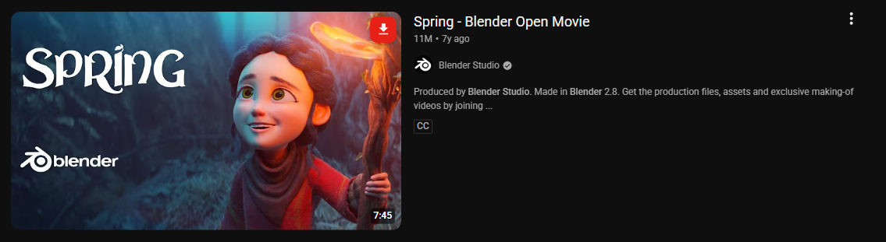
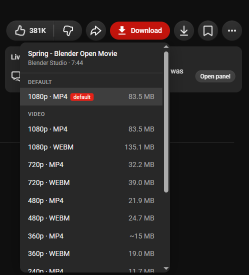
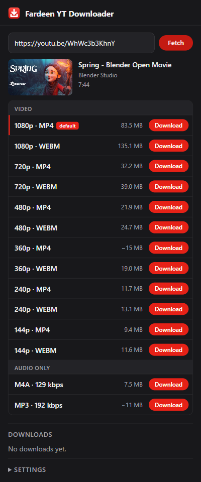
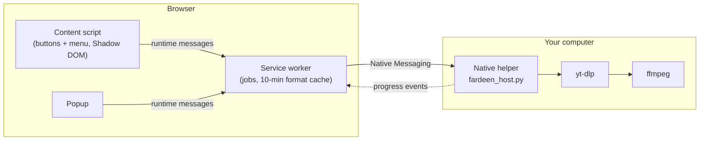

<div align="center">


# Fardeen YT Downloader

**Download YouTube videos and Shorts in any quality, with the exact file size shown before you click.**

[](https://developer.chrome.com/docs/extensions/develop/migrate/what-is-mv3)
[](https://www.python.org/)
[](https://github.com/yt-dlp/yt-dlp)
[](#installation)
[](LICENSE)

[Features](#features) · [Installation](#installation) · [Usage](#usage) · [How it works](#how-it-works) · [Troubleshooting](#troubleshooting) · [Development](#development)

</div>

---

## Screenshots

<table>
  <tr>
    <td width="58%" valign="top">
      <b>Red download button on every thumbnail</b><br>
      
      <br><br>
      <b>Quality menu with file sizes on the watch page</b><br>
      
    </td>
    <td width="42%" valign="top">
      <b>Paste any link in the popup</b><br>
      
    </td>
  </tr>
</table>

> The extension's buttons are always **red**, so they are never confused with YouTube's own grey buttons,
> including YouTube Premium's download button in the same row.

## Features

- **One-click download from anywhere on YouTube.** A red download button appears on video and Short
  thumbnails (home, search, subscriptions, channel pages, the watch-page sidebar, the Shorts shelf and
  playlists), next to Like / Share on the watch page, and in the Shorts action bar.
- **See the size before you download.** Every option shows its file size (`48.2 MB`). Estimates are marked
  with a tilde (`~48 MB`). For HD formats the size includes the matching audio track.
- **Every quality up to 4K / 60 fps**, in MP4 or WebM, plus **MP3** and **M4A** audio.
- **Live progress**: percent, speed and time left, with **Cancel** and **Show in folder**.
- **Popup for any link**: `youtube.com/watch`, `youtu.be`, `/shorts/`, `m.youtube.com`, and links with
  `&t=` or `&list=`. When the current tab is a video, its link is filled in automatically.
- **Settings**: download folder, default quality, filename template and the thumbnail buttons on/off.
- **Clear errors** for private, age-restricted, members-only, live, region-blocked and removed videos,
  for a missing ffmpeg, and for a full disk.
- **Private by design**: no analytics, no remote code, and no server between you and YouTube.

## Installation

The extension shows the buttons. The downloading is done by a small **helper app** on your computer that
runs [yt-dlp](https://github.com/yt-dlp/yt-dlp) and [ffmpeg](https://ffmpeg.org/). You set it up once.

### 1. Install the tools

| | Windows | macOS | Linux (Debian/Ubuntu) |
|---|---|---|---|
| Python 3.8+ | [python.org](https://www.python.org/downloads/) (tick *Add python.exe to PATH*) | `brew install python` | `sudo apt install python3` |
| yt-dlp | `pip install -U yt-dlp` | `pip3 install -U yt-dlp` | `pip3 install -U yt-dlp` |
| ffmpeg | `winget install Gyan.FFmpeg` | `brew install ffmpeg` | `sudo apt install ffmpeg` |
| Deno *(recommended)* | `winget install DenoLand.Deno` | `brew install deno` | `curl -fsSL https://deno.land/install.sh \| sh` |

ffmpeg is needed for 720p and above (video and audio are merged) and for MP3. yt-dlp needs a JavaScript
runtime to see every YouTube format: Deno is preferred, and Node.js is used automatically if it's present.

### 2. Load the extension

1. Download this repository (**Code → Download ZIP**, then extract) or `git clone` it.
2. Open `chrome://extensions`, turn on **Developer mode** (top right) and click **Load unpacked**.
3. Select the **`extension`** folder.
4. Copy the **ID** shown on the *Fardeen YT Downloader* card (32 letters).

### 3. Install the helper

- **Windows:** double-click `host\install.bat` and paste the ID when asked.
- **macOS / Linux:** `chmod +x host/install.sh && ./host/install.sh <EXTENSION_ID>`

The installer registers the helper for Chrome, Edge, Chromium and Brave and checks that yt-dlp and ffmpeg
are installed.

### 4. Restart the browser

Close **every** browser window, reopen it and refresh any open YouTube tabs. Click the toolbar icon: you
should see the link box. If you see *Setup required*, see [Troubleshooting](#troubleshooting).

> [!NOTE]
> The extension ID depends on the folder you loaded it from. If you move the folder, load it again and
> re-run the installer with the new ID.

## Usage

| Where | How |
|---|---|
| Thumbnails | Hover a thumbnail and click the red icon in its top-right corner |
| Watch page | Click the red **Download** button next to Like / Share |
| Shorts | Click the red **Download** button in the right-hand action bar |
| Any link | Click the toolbar icon, paste the link and press **Fetch** |

Pick a quality. Progress appears in place of the menu and in the popup's **Downloads** list, where you can
cancel or open the folder once it's done.

### Settings

| Setting | Default | Notes |
|---|---|---|
| Download folder | your *Downloads* folder | A full path; created if it doesn't exist |
| Default quality | 1080p | Highlighted and listed first in every menu |
| Filename template | `{title} [{id}]` | Fields: `{title}` `{id}` `{channel}` `{date}` `{quality}` |
| Thumbnail buttons | On | Turn off to hide the buttons on thumbnails |

## How it works



Downloading straight from the browser doesn't work well: YouTube scrambles its stream URLs, slows down
direct requests, and serves anything above 360p as separate video and audio streams that must be merged.
So the extension uses Chrome's [Native Messaging](https://developer.chrome.com/docs/extensions/develop/concepts/native-messaging)
to hand the work to a local helper:

- **`get_formats`** runs `yt-dlp -J` and returns a de-duplicated list of qualities. Video-only streams are
  paired with the best matching stereo audio, and their **combined** size is shown. The size comes from
  `filesize`, then `filesize_approx`, then bitrate × duration; the last two are marked approximate.
- **`download`** streams progress back (percent, speed, time left), merges with ffmpeg, converts to MP3 when
  chosen and saves to your folder. Partial files go to a temporary folder that is deleted on cancel or
  failure.
- **`cancel`**, **`open_folder`** and **`check_dependencies`** do what their names say.

Only a validated 11-character video ID and a validated format ID are sent to the helper, never a raw URL,
so nothing you paste can reach the yt-dlp command line.

## Troubleshooting

| Message or symptom | Fix |
|---|---|
| *Setup required* | The helper isn't registered, or it's registered for another ID. Re-run the installer with the ID shown in the popup, then restart the browser. |
| *YouTube refused the download (HTTP 403)* or *not a bot* | Update yt-dlp: `pip install -U yt-dlp`. YouTube changes often, and old yt-dlp versions stop working. |
| *ffmpeg is not installed* | Install ffmpeg (see above), then restart the browser. |
| *age-restricted*, *members only*, *private* | These need a signed-in account, which this extension doesn't use. |
| *Live streams … can't be downloaded* | Wait until the stream or premiere has ended. |
| *Your disk is full* | Free up space or choose another download folder. |
| No buttons on the page | Refresh the YouTube tab after installing or updating the extension. If YouTube changed its layout, update [`extension/content/selectors.js`](extension/content/selectors.js). |

Check the helper's tools at any time with `python host/fardeen_host.py --check`, and remove the helper
with `python host/fardeen_host.py --uninstall`.

## Development

### Project structure

```
extension/                 Chrome extension (load this folder)
├── manifest.json
├── background.js          service worker: native-host bridge, job store, format cache
├── lib/common.js          shared helpers: link parsing, size formatting, default-quality pick
├── content/selectors.js   every YouTube DOM selector, in one place
├── content/content.js     thumbnail / watch / Shorts buttons and the quality menu
├── popup/                 popup UI: paste link, downloads, settings, setup screen
└── icons/                 generated by tools/make_icons.py
host/
├── fardeen_host.py        native messaging host (Python standard library only)
├── install.bat            Windows installer
└── install.sh             macOS / Linux installer
tools/make_icons.py        renders the PNG icons from the same geometry as docs/logo.svg
tests/                     unit tests for the extension helpers and the native host
docs/                      logo and screenshots
```

### Tests

```bash
node --test tests/common.test.js          # link parsing, size formatting, default quality
python -m unittest discover -s tests      # format selection, sizes, progress, validation, errors
```

### When YouTube changes its layout

All selectors live in [`extension/content/selectors.js`](extension/content/selectors.js). Thumbnails are
found by structure (a link to `/watch?v=` or `/shorts/` that contains a thumbnail element), not by class
names. The video ID is read from the link at click time, so recycled elements always download the right
video. After editing, click **Reload** on the extension card and refresh YouTube.

### Manual test checklist

- [ ] Home feed, search and sidebar thumbnails show the red button on hover; clicking it opens the menu,
      not the video. Thumbnails loaded by scrolling get exactly one button each.
- [ ] Shorts shelf thumbnails and the `/shorts` player (after swiping to the next Short) both work.
- [ ] Watch page: one red **Download** button next to Like / Share, in light and dark theme, also after
      navigating to another video.
- [ ] The menu shows a spinner, then qualities with sizes (`~` for estimates) and MP3 / M4A. Reopening
      within 10 minutes is instant.
- [ ] Popup: `youtu.be/…`, `/shorts/…`, `m.youtube.com/…`, `&t=` and `&list=` links all fetch the single
      video; `hello` shows a clear error; a YouTube tab pre-fills the link.
- [ ] A 1080p download shows progress, then *Merging…*, then *Saved*, and plays with sound.
      **Show in folder** highlights the file.
- [ ] MP3 shows *Converting to MP3…* and the file plays.
- [ ] Cancel stops the download and leaves no partial files behind.
- [ ] Private, age-restricted and upcoming-premiere videos show clear messages.
- [ ] Changing the folder, template and default quality takes effect; turning off thumbnail buttons hides
      them right away.
- [ ] After `python host/fardeen_host.py --uninstall` and a browser restart, the popup and menus show
      *Setup required* with the extension ID.

## Disclaimer

This project is not affiliated with or endorsed by YouTube or Google. Only download videos you own or have
permission to download, and respect YouTube's Terms of Service and the copyright law of your country.
Screenshots show [Blender Studio](https://studio.blender.org/) open movies (CC BY).

## License

[MIT](LICENSE) © 2026 Fardeen
